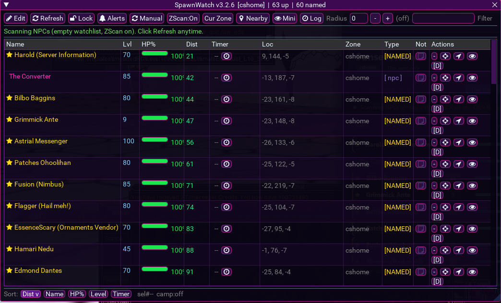
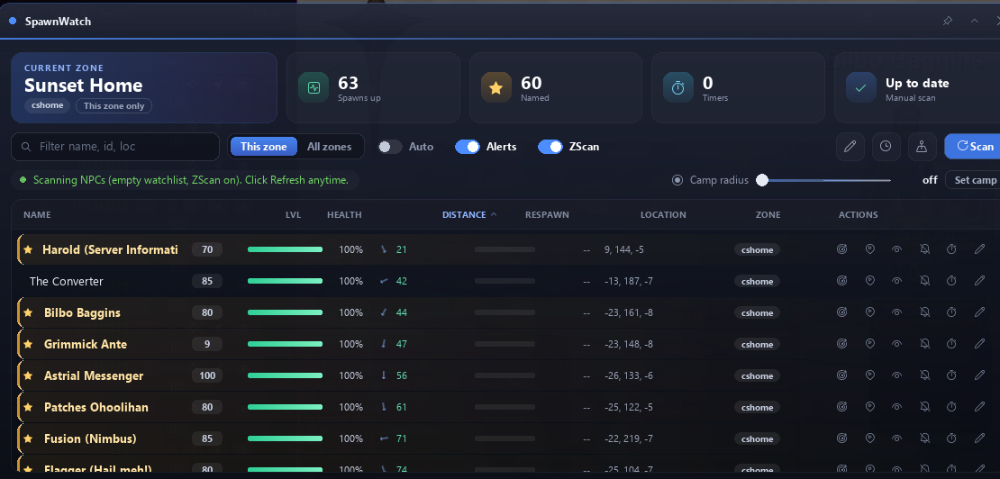

# MQ2RmlUi

MacroQuest plugin that hosts [RmlUi](https://github.com/mikke89/RmlUi) (HTML/CSS-style documents) on the RoF2 emu DX9 client.

Lua scripts talk to it through exported MQ commands / TLO bindings; this PR is **plugin source only**.

## Screenshots

### Example UI — ImGui (before)



### Example UI — RmlUi via MQ2RmlUi (after)



## Build (standalone, Win32)

Requires:

- Visual Studio 2022 (Win32 / x86 toolset)
- [vcpkg](https://vcpkg.io/) with `RmlUi:x86-windows-static`
- Running MacroQuest install (for import libs against `MQ2Main.dll` / `imgui.dll` export tables)

```powershell
$env:VCPKG_ROOT = "C:\vcpkg"   # your vcpkg root
.\build.ps1 -NoDeploy
# or deploy:
.\build.ps1 -MQRoot "C:\path\to\MacroQuest"
```

Output: `build\Release\MQ2RmlUi.dll` → copy into `plugins\`, then `/plugin MQ2RmlUi`.

`tools\rml_preview.cpp` is an offline D3D9 smoke renderer (no game required).

## Layout

| Path | Purpose |
|------|---------|
| `src/MQ2RmlUi.cpp` | Plugin entry, document host, Lua-facing API |
| `src/RenderInterface_DX9.*` | RmlUi → Direct3D 9 backend |
| `src/mq_api.h` | Minimal MQ / ImGui import surface |
| `defs/*.def` | Import libraries from shipped MQ DLLs |
| `third_party/imgui` | Header subset matching MQ ImGui |
| `third_party/stb` | Image decode for textures |
| `CMakeLists.txt` / `build.ps1` | Win32 Release build |

## Notes

- Targets **32-bit** RoF2 emu (`-A Win32`). Do not configure as x64.
- RmlUi is pulled from vcpkg; it is not vendored here.
